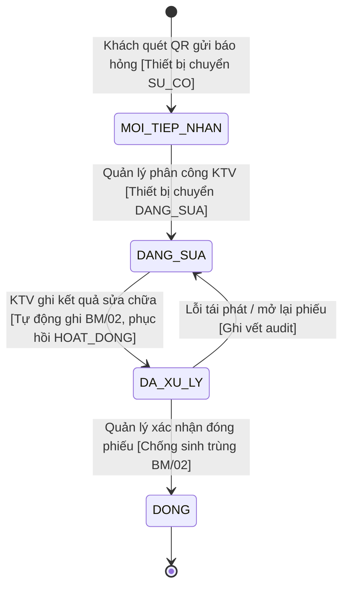
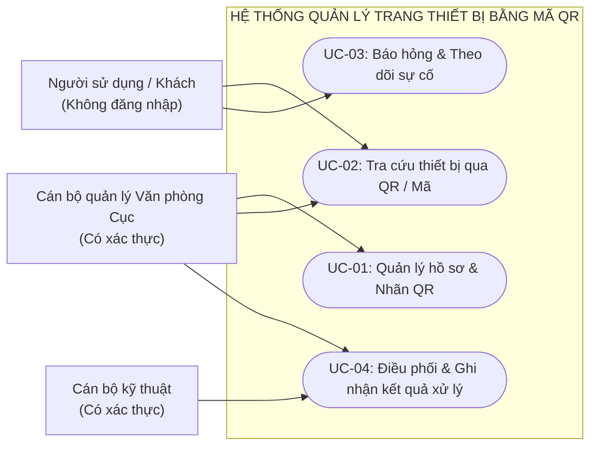
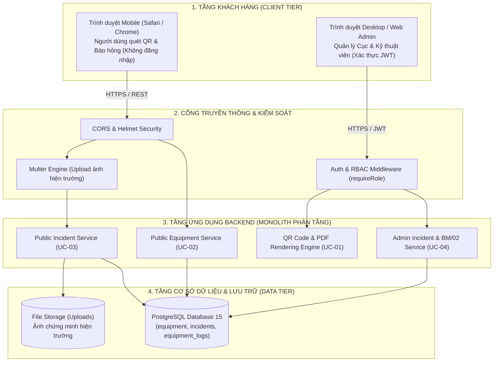

# ĐẠI HỌC BÁCH KHOA HÀ NỘI
## TRƯỜNG ĐIỆN - ĐIỆN TỬ

---

# BÁO CÁO BÀI TẬP LỚN
### HỌC PHẦN: KỸ THUẬT PHẦN MỀM & ỨNG DỤNG (ET3161)

## ĐỀ TÀI: HỆ THỐNG QUẢN LÝ TRANG THIẾT BỊ BẰNG MÃ QR (HỖ TRỢ QUY TRÌNH QT.QLD.09.01 - CỤC QUẢN LÝ DƯỢC)

* **Sinh viên thực hiện:**
  1. Văn Đình Bách – MSSV: 202414677
  2. Trần Quốc Minh Hiếu – MSSV: 202414713
  3. Đỗ Duy Mạnh – MSSV: 202414749
  4. Đào Quý Thái – MSSV: 202414790
  5. Nguyễn Thành Vinh – MSSV: 202414815
* **Giảng viên hướng dẫn:** TS. Nguyễn Thanh Bình
* **Mã lớp học phần:** 176028
* **Khoa/Trường:** Trường Điện - Điện tử, Đại học Bách Khoa Hà Nội

*Hà Nội, 11/2026*

---

# MỤC LỤC

- [CHƯƠNG 1. TỔNG QUAN VÀ PHÂN TÍCH QUY TRÌNH NGHIỆP VỤ](#chương-1-tổng-quan-và-phân-tích-quy-trình-nghiệp-vụ)
  - [1.1 Giới thiệu và bối cảnh](#11-giới-thiệu-và-bối-cảnh)
  - [1.2 Quy trình nghiệp vụ QT.QLD.09.01](#12-quy-trình-nghiệp-vụ-qtqld0901)
  - [1.3 Xác định vấn đề](#13-xác-định-vấn-đề)
    - [1.3.1 Phân tích hoạt động trong các bước được chọn](#131-phân-tích-hoạt-động-trong-các-bước-được-chọn)
    - [1.3.2 Điểm nghẽn và bản chất vấn đề](#132-điểm-nghẽn-và-bản-chất-vấn-đề)
    - [1.3.3 Khả năng tự động hóa và phạm vi hệ thống](#133-khả-năng-tự-động-hóa-và-phạm-vi-hệ-thống)
    - [1.3.4 Phạm vi hệ thống](#134-phạm-vi-hệ-thống)
  - [1.4 Kết luận chương 1](#14-kết-luận-chương-1)
- [CHƯƠNG 2. PHÂN TÍCH YÊU CẦU](#chương-2-phân-tích-yêu-cầu)
  - [2.1 Các bên liên quan](#21-các-bên-liên-quan)
  - [2.2 Yêu cầu người dùng (User Requirements - UR)](#22-yêu-cầu-người-dùng-user-requirements---ur)
  - [2.3 Yêu cầu hệ thống (System Requirements - SR)](#23-yêu-cầu-hệ-thống-system-requirements---sr)
    - [2.3.1 Trạng thái của Thiết bị và Phiếu sự cố](#231-trạng-thái-của-thiết-bị-và-phiếu-sự-cố)
    - [2.3.2 Danh sách yêu cầu hệ thống](#232-danh-sách-yêu-cầu-hệ-thống)
    - [2.3.3 Quy tắc xử lý và chuyển trạng thái nghiệp vụ](#233-quy-tắc-xử-lý-và-chuyển-trạng-thái-nghiệp-vụ)
    - [2.3.4 Giả định khi làm rõ yêu cầu](#234-giả-định-khi-làm-rõ-yêu-cầu)
    - [2.3.5 Các yêu cầu bị loại khỏi phạm vi](#235-các-yêu-cầu-bị-loại-khỏi-phạm-vi)
  - [2.4 Yêu cầu phi chức năng (Non-Functional Requirements - NFR)](#24-yêu-cầu-phi-chức-năng-non-functional-requirements---nfr)
  - [2.5 Từ điển dữ liệu (Data Dictionary)](#25-từ-điển-dữ-liệu-data-dictionary)
    - [2.5.1 Thông tin thiết bị và tem QR (Bảng `equipment`)](#251-thông-tin-thiết-bị-và-tem-qr-bảng-equipment)
    - [2.5.2 Thông tin phiếu báo hỏng và sự cố (Bảng `incidents`)](#252-thông-tin-phiếu-báo-hỏng-và-sự-cố-bảng-incidents)
    - [2.5.3 Thông tin tệp đính kèm hiện trường (Bảng `attachments`)](#253-thông-tin-tệp-đính-kèm-hiện-trường-bảng-attachments)
    - [2.5.4 Thông tin lý lịch máy tự động BM/02 (Bảng `equipment_logs`)](#254-thông-tin-lý-lịch-máy-tự-động-bm02-bảng-equipment_logs)
    - [2.5.5 Danh mục đơn vị và cán bộ (`departments`, `users`, `roles`)](#255-danh-mục-đơn-vị-và-cán-bộ-departments-users-roles)
  - [2.6 Yêu cầu chức năng và ma trận truy vết](#26-yêu-cầu-chức-năng-và-ma-trận-truy-vết)
    - [2.6.1 Danh sách yêu cầu chức năng (FR)](#261-danh-sách-yêu-cầu-chức-năng-fr)
    - [2.6.2 Ma trận truy vết yêu cầu chức năng](#262-ma-trận-truy-vết-yêu-cầu-chức-năng)
    - [2.6.3 Ma trận truy vết yêu cầu phi chức năng](#263-ma-trận-truy-vết-yêu-cầu-phi-chức-năng)
    - [2.6.4 Kiểm tra độ bao phủ](#264-kiểm-tra-độ-bao-phủ)
- [CHƯƠNG 3. ITERATION 0 – KHỞI ĐẦU DỰ ÁN (INCEPTION)](#chương-3-iteration-0--khởi-đầu-dự-án-inception)
  - [3.1 Tầm nhìn và phạm vi](#31-tầm-nhìn-và-phạm-vi)
    - [3.1.1 Tuyên bố tầm nhìn](#311-tuyên-bố-tầm-nhìn)
    - [3.1.2 Mục tiêu và tiêu chí thành công](#312-mục-tiêu-và-tiêu-chí-thành-công)
    - [3.1.3 Phạm vi sau khi tinh chỉnh](#313-phạm-vi-sau-khi-tinh-chỉnh)
  - [3.2 Product Backlog ban đầu](#32-product-backlog-ban-đầu)
  - [3.3 Sơ đồ Use Case mức cao](#33-sơ-đồ-use-case-mức-cao)
    - [3.3.1 Tác nhân](#331-tác-nhân)
    - [3.3.2 Danh sách Use Case](#332-danh-sách-use-case)
    - [3.3.3 Quan hệ giữa các Use Case](#333-quan-hệ-giữa-các-use-case)
    - [3.3.4 Những gì không có trên sơ đồ](#334-những-gì-không-có-trên-sơ-đồ)
  - [3.4 Sơ đồ lớp khái niệm (Domain Model)](#34-sơ-đồ-lớp-khái-niệm-domain-model)
    - [3.4.1 Các lớp miền](#341-các-lớp-miền)
    - [3.4.2 Quan hệ và bội số](#342-quan-hệ-và-bội-số)
    - [3.4.3 Kiểu liệt kê và ràng buộc](#343-kiểu-liệt-kê-và-ràng-buộc)
    - [3.4.4 Các quyết định mô hình hóa](#344-các-quyết-định-mô-hình-hóa)
  - [3.5 Mô hình dữ liệu ban đầu (ERD)](#35-mô-hình-dữ-liệu-ban-đầu-erd)
    - [3.5.1 Thực thể và khóa](#351-thực-thể-và-khóa)
    - [3.5.2 Quan hệ và bản số](#352-quan-hệ-và-bản-số)
    - [3.5.3 Khác biệt so với sơ đồ lớp](#353-khác-biệt-so-với-sơ-đồ-lớp)
  - [3.6 Kiến trúc khung (Architectural Framework)](#36-kiến-trúc-khung-architectural-framework)
    - [3.6.1 Các thành phần kiến trúc](#361-các-thành-phần-kiến-trúc)
    - [3.6.2 Lý do lựa chọn kiến trúc](#362-lý-do-lựa-chọn-kiến-trúc)
    - [3.6.3 Các phương án bị loại](#363-các-phương-án-bị-loại)
    - [3.6.4 Bộ khung chạy được (Walking Skeleton) & Minh chứng kiểm thử](#364-bộ-khung-chạy-được-walking-skeleton--minh-chứng-kiểm-thử)
    - [3.6.5 Đối chiếu bốn mô hình](#365-đối-chiếu-bốn-mô-hình)
  - [3.7 Công cụ dự án](#37-công-cụ-dự-án)
  - [3.8 Kết luận chương và các vấn đề còn mở](#38-kết-luận-chương-và-các-vấn-đề-còn-mở)
- [TÀI LIỆU THAM KHẢO](#tài-liệu-tham-khảo)

---

# CHƯƠNG 1. TỔNG QUAN VÀ PHÂN TÍCH QUY TRÌNH NGHIỆP VỤ

## 1.1 Giới thiệu và bối cảnh
Cục Quản lý Dược (Bộ Y tế) là cơ quan nhà nước thực hiện chức năng quản lý nhà nước về dược phẩm, mỹ phẩm và trang thiết bị y tế liên quan. Nhằm duy trì hệ thống quản lý chất lượng theo tiêu chuẩn ISO 9001, Cục đã ban hành Quy trình Quản lý Trang thiết bị mã hiệu **QT.QLD.09.01** (áp dụng cho toàn thể 11 đơn vị, phòng ban thuộc Cục).

Hệ thống quản lý trang thiết bị hiện hành chủ yếu dựa trên các sổ sách giấy tờ, bảng tính Excel phân tán và việc trao đổi trực tiếp hoặc gọi điện thoại. Khi trang thiết bị (máy tính, máy in, máy scan, máy photocopy, thiết bị mạng, điều hòa...) xảy ra hỏng hóc, cán bộ tại các phòng chuyên môn thường thông báo bằng lời nói hoặc gửi tin nhắn riêng lẻ tới Văn phòng Cục. Cách làm truyền thống này dẫn đến nhiều bất cập:
* Khó xác định chính xác thông tin máy thực tế (nhầm lẫn giữa hàng chục máy cùng hãng, cùng model trong cùng phòng làm việc).
* Không tập trung được thông tin phiếu báo hỏng, gây thất lạc, bỏ sót sự cố.
* Lịch sử sửa chữa, bảo dưỡng phân mảnh; khi khắc phục xong cán bộ quên cập nhật sổ lý lịch máy (BM/02), dẫn đến sai lệch hồ sơ chất lượng.

Chương này phân tích quy trình QT.QLD.09.01, làm rõ các điểm nghẽn thực tế, đánh giá mức độ tự động hóa và chốt phạm vi hệ thống số hóa ứng dụng công nghệ mã QR.

---

## 1.2 Quy trình nghiệp vụ QT.QLD.09.01
Quy trình QT.QLD.09.01 gồm 9 bước nghiệp vụ tuần tự và song song (Bảng 1.1).

**Bảng 1.1 Các bước của quy trình nghiệp vụ QT.QLD.09.01**
| Mã BP | Bước quy trình | Đơn vị thực hiện | Nội dung chính | Biểu mẫu áp dụng |
| :---: | :--- | :--- | :--- | :---: |
| **BP-01** | Lập danh mục trang thiết bị | Văn phòng Cục; Các phòng ban | Tiếp nhận bàn giao, lập và định kỳ rà soát danh mục toàn bộ trang thiết bị của Cục. | BM/01 |
| **BP-02** | Lập và quản lý hồ sơ thiết bị | Văn phòng Cục; Đơn vị sử dụng | Mở hồ sơ riêng cho từng thiết bị, cập nhật lịch sử biến động, sửa chữa, bảo dưỡng vào lý lịch máy. | BM/02 |
| **BP-03** | Tiếp nhận và xử lý sự cố | Người sử dụng; Văn phòng Cục | Phát hiện sự cố, thông báo báo hỏng, kiểm tra hiện trường, xác định nguyên nhân và phân loại xử lý. | BM/02, BM/03 |
| **BP-04** | Tự khắc phục sự cố nhỏ | Kỹ thuật viên Văn phòng Cục | Cán bộ kỹ thuật trực tiếp khắc phục các sự cố phần mềm, kẹt giấy, thay linh kiện sẵn có tại chỗ. | BM/02 |
| **BP-05** | Lập phương án sửa chữa thuê ngoài | Văn phòng Cục | Với sự cố lớn vượt quá khả năng tự sửa, lập tờ trình phương án sửa chữa và dự toán kinh phí. | BM/03 |
| **BP-06** | Phê duyệt phương án | Lãnh đạo Cục | Lãnh đạo Cục xem xét căn cứ kỹ thuật, dự toán tài chính để duyệt hoặc yêu cầu chỉnh sửa. | Tờ trình / BM/03 |
| **BP-07** | Tổ chức thực hiện sửa chữa | Văn phòng Cục; Nhà thầu dịch vụ | Ký hợp đồng dịch vụ, giám sát nhà thầu tháo lắp, thay thế linh kiện, chạy thử nghiệm thiết bị. | Hợp đồng / Biên bản |
| **BP-08** | Kiểm tra, nghiệm thu | Bên giao (Nhà thầu); Bên nhận (VPC, Đơn vị) | Hai bên đại diện cùng kiểm tra vận hành, ký biên bản bàn giao và nghiệm thu sửa chữa. | BM/04 |
| **BP-09** | Lưu trữ hồ sơ chất lượng | Văn phòng Cục; Ban QMS | Cập nhật kết quả vào lý lịch máy BM/02; lưu trữ hồ sơ phục vụ đánh giá nội bộ và kiểm toán ISO. | BM/02, BM/04 |

### Lý do lựa chọn bước BP-01, BP-02 và nhánh đầu BP-03 làm phạm vi hạt nhân:
1. **Là nơi dữ liệu gốc của từng thiết bị được tạo ra và sử dụng hàng ngày:** Toàn bộ vòng đời tài sản phụ thuộc vào việc định danh chính xác ở BP-01 và BP-02. Nếu định danh sai từ đầu thì mọi biên bản, phương án ở các bước sau đều sai lệch.
2. **Là điểm tiếp xúc nhiều nhất giữa người sử dụng vãng lai/cán bộ phòng ban với cơ quan quản lý:** Khâu báo hỏng (nhánh đầu BP-03) diễn ra thường xuyên nhất, đòi hỏi thao tác tức thời, nhanh gọn trên thiết bị di động mà không bắt buộc cài đặt phần mềm phức tạp hay đăng nhập tài khoản.
3. **Phù hợp với giải pháp tem QR Code dán trên thân máy:** Người dùng quét mã QR tại chỗ để tra cứu ngay hồ sơ máy và gửi báo hỏng tức thời kèm ảnh chụp hiện trường.

---

## 1.3 Xác định vấn đề

### 1.3.1 Phân tích hoạt động trong các bước được chọn
Nhóm bóc tách các bước được chọn thành các hoạt động chi tiết (Bảng 1.2).

**Bảng 1.2 Chi tiết các hoạt động trong phạm vi lựa chọn**
| Mã HĐ | Người thực hiện | Hoạt động chi tiết theo quy trình thực tế |
| :---: | :--- | :--- |
| **1.1** | Cán bộ Văn phòng Cục | Tiếp nhận thiết bị mới từ nguồn mua sắm/bàn giao, ghi nhận số seri, model, hãng sản xuất, đơn vị tiếp nhận quản lý. |
| **1.2** | Cán bộ Văn phòng Cục | Cấp mã quản lý chuẩn (dạng `TT-YYYY-xxx`), in và dán nhãn định danh lên thân thiết bị; lưu vào Sổ danh mục thiết bị (BM/01). |
| **2.1** | Cán bộ Văn phòng Cục | Lập tờ bìa và các trang ghi chép Lý lịch trang thiết bị (BM/02) lưu tại tủ hồ sơ hoặc file Word/Excel. |
| **2.2** | Cán bộ phòng ban sử dụng | Khi cần đối chiếu tình trạng máy, liên hệ Văn phòng Cục để tra sổ giấy hoặc tìm file danh mục để xem thông tin kỹ thuật. |
| **3.1** | Người sử dụng (cán bộ/khách) | Phát hiện máy in kẹt giấy, máy tính hỏng nguồn, máy scan mất kết nối; tìm cách gọi điện hoặc nhắn tin cho cán bộ Văn phòng. |
| **3.2** | Cán bộ Văn phòng Cục | Ghi nhận thông tin báo hỏng vào sổ tay, hỏi lại địa điểm, phòng ban và mã thiết bị cụ thể (thường mất nhiều cuộc gọi qua lại). |
| **3.3** | Cán bộ Văn phòng Cục | Đánh giá sơ bộ nguyên nhân, phân công kỹ thuật viên phụ trách đến hiện trường kiểm tra. |
| **3.4** | Kỹ thuật viên Văn phòng Cục | Tiếp cận thiết bị, xử lý sự cố (khắc phục tại chỗ); thông báo hoàn thành cho người dùng. |
| **3.5** | Cán bộ Văn phòng Cục | Ghi nhận kết quả xử lý vào mục II của Sổ lý lịch máy BM/02 và đưa thiết bị trở lại hoạt động bình thường. |

---

### 1.3.2 Điểm nghẽn và bản chất vấn đề
Từ thực tế khảo sát, nhóm xác định được **ba vấn đề cốt lõi (VĐ1, VĐ2, VĐ3)**:

#### Vấn đề 1: Nhận diện sai thiết bị và hồ sơ giấy phân tán (Hoạt động 1.1, 1.2, 2.1, 2.2)
* **Biểu hiện:** Mã thiết bị sơn hoặc dán nhãn giấy truyền thống dễ bong tróc, mờ số. Một phòng chuyên môn có 5–10 chiếc máy in cùng dòng HP LaserJet, khi báo hỏng người dùng chỉ báo "máy in phòng 204 bị hỏng", kỹ thuật viên đến nơi không biết chính xác chiếc nào. Muốn xem lịch sử máy phải lục tìm sổ lưu trữ BM/02 tại kho văn thư.
* **Nguyên nhân gốc & Hướng giải quyết:** Thiếu cơ chế định danh số hóa trực tiếp trên thiết bị. *Hướng giải quyết:* Cấp mã định danh duy nhất dạng UUID v4 cho mỗi máy, gắn vào **tem mã QR chống nước** dán trên thân máy. Bất kỳ ai dùng camera điện thoại quét mã đều truy xuất được hồ sơ máy tức thời mà không cần tra sổ giấy.

#### Vấn đề 2: Kênh báo hỏng thủ công, thiếu tập trung và nghẽn luồng tiếp nhận (Hoạt động 3.1, 3.2, 3.3)
* **Biểu hiện:** Thông tin báo sự cố qua nhiều kênh không chính thức (điện thoại, Zalo, gọi trực tiếp). Cán bộ phụ trách đi vắng hoặc bận họp sẽ làm trôi tin nhắn. Người báo không có ảnh chụp triệu chứng nên kỹ thuật viên không chuẩn bị sẵn linh kiện thay thế. Nhiều người cùng báo một sự cố gây quá tải; người báo không biết sự cố của mình đã có ai tiếp nhận xử lý chưa.
* **Nguyên nhân gốc & Hướng giải quyết:** Quy trình chưa có cổng tiếp nhận công khai trực tuyến. *Hướng giải quyết:* Xây dựng cổng Web App báo hỏng qua mã QR: quét mã là hiển thị ngay form báo hỏng đã điền sẵn tên máy, vị trí; cho phép đính kèm ảnh hiện trường, kiểm tra chống gửi lặp (Idempotency) và cung cấp mã tra cứu bí mật `TK-xxxxxxxx` để theo dõi tiến độ ẩn danh.

#### Vấn đề 3: Đứt gãy cập nhật Lý lịch máy BM/02 và sai lệch trạng thái thiết bị (Hoạt động 3.4, 3.5)
* **Biểu hiện:** Sau khi kỹ thuật viên sửa xong máy, việc ghi sổ BM/02 thường bị trì hoãn hoặc lãng quên. Đến kỳ kiểm toán ISO 9001, cán bộ phải "hồi tố" ghi chép lại dựa trên trí nhớ dẫn đến sai lệch thời gian, thiếu sót lịch sử sửa chữa. Trạng thái thiết bị trên danh mục vẫn để "Hoạt động" trong khi thực tế đang đắp chiếu chờ sửa.
* **Nguyên nhân gốc & Hướng giải quyết:** Khâu kết thúc sự cố và khâu ghi chép hồ sơ bị tách rời thành hai hành động thủ công riêng biệt. *Hướng giải quyết:* Tự động hóa liên kết trạng thái: Khi quản lý xác nhận hoàn tất sự cố (`DA_XU_LY`), hệ thống tự động sinh một bản ghi lý lịch máy vào bảng `equipment_logs` (chuẩn biểu mẫu BM/02), đồng thời tự động kiểm tra nếu không còn sự cố mở thì tự khôi phục thiết bị về trạng thái `HOAT_DONG`.

**Bảng 1.3 Minh họa ví dụ thực tế quy tắc xử lý trạng thái và ghi lý lịch BM/02**
| Tình huống thực tế | Trạng thái phiếu sự cố | Trạng thái thiết bị | Tác động tới Lý lịch máy (BM/02) |
| :--- | :--- | :--- | :--- |
| Người dân quét QR báo hỏng máy photocopy | Khởi tạo: `MOI_TIEP_NHAN` | Tự chuyển sang: `SU_CO` | Chưa ghi lý lịch (chờ xử lý xong). |
| Quản lý phân công KTV Trần Văn Kỹ Thuật | Chuyển sang: `DANG_SUA` | Đồng bộ sang: `DANG_SUA` | Ghi nhận thời điểm phân công và người phụ trách. |
| KTV sửa xong, ghi chú "Thay gạt mực, bôi trơn bánh răng" | Chuyển sang: `DA_XU_LY` | Tự động phục hồi: `HOAT_DONG` (nếu hết phiếu mở) | **Tự động INSERT 01 dòng vào `equipment_logs`** ghi rõ nội dung, ngày thực hiện, người làm. |
| Lãnh đạo phê duyệt đóng phiếu | Chuyển sang: `DONG` | Giữ nguyên: `HOAT_DONG` | **Chống ghi trùng:** Không sinh thêm dòng BM/02 thứ hai. |

---

### 1.3.3 Khả năng tự động hóa và phạm vi hệ thống

**Bảng 1.4 Đánh giá khả năng tự động hóa các hoạt động**
| Mã HĐ | Hoạt động nghiệp vụ | VĐ | Mức độ | Cách thức hệ thống hỗ trợ / Lý do |
| :---: | :--- | :---: | :---: | :--- |
| **1.1** | Kiểm tra xuất xứ, bàn giao tài sản thực tế | VĐ1 | **Không** | Cần cán bộ đối soát biên bản bàn giao và tem mác vật lý ngoài đời thực. |
| **1.2** | Cấp mã định danh, sinh mã QR, xuất file in tem | VĐ1 | **Tự động** | Hệ thống tự sinh mã UUID, render ảnh QR Code độ phân giải cao và xuất file PDF nhãn in chuẩn kích thước tem dán. |
| **2.1** | Mở sổ hồ sơ lý lịch thiết bị | VĐ1 | **Tự động** | Khởi tạo bản ghi trong CSDL `equipment`, cấp khóa nội bộ và mã quản lý. |
| **2.2** | Tra cứu hồ sơ máy tại hiện trường | VĐ1 | **Tự động** | Quét QR mở ngay thông tin công khai (tên máy, model, tình trạng, đơn vị quản lý). |
| **3.1** | Phát hiện hỏng hóc thực tế | VĐ2 | **Không** | Do giác quan con người phát hiện khi vận hành thiết bị. |
| **3.2** | Nhập form báo hỏng, gửi ảnh hiện trường | VĐ2 | **Bán tự động**| Form web tự điền thông tin máy; người dùng nhập số điện thoại, mô tả và tải ảnh lên. |
| **3.2a**| Kiểm tra chống báo hỏng trùng lặp | VĐ2 | **Tự động** | Hệ thống kiểm tra nếu thiết bị đang có phiếu sự cố chưa đóng thì chặn và cảnh báo mã lỗi HTTP 409 Conflict. |
| **3.2b**| Chống gửi lặp do độ trễ mạng (Idempotency) | VĐ2 | **Tự động** | So khớp khóa `request_id`, nếu gửi lặp thì trả về phiếu cũ, không tạo bản ghi rác. |
| **3.3** | Phân công cán bộ kỹ thuật | VĐ2 | **Bán tự động**| Cán bộ quản lý chọn kỹ thuật viên từ danh sách gợi ý; hệ thống tự đổi trạng thái sang `DANG_SUA`. |
| **3.4** | Thao tác sửa chữa phần cứng/linh kiện | VĐ3 | **Không** | Kỹ thuật viên thao tác vật lý trên thiết bị ngoài đời thực. |
| **3.5** | Ghi nhận kết quả vào Lý lịch máy BM/02 | VĐ3 | **Tự động** | Khi phiếu chuyển sang `DA_XU_LY`, hệ thống tự chèn dòng nhật ký sửa chữa vào bảng `equipment_logs`. |
| **3.5a**| Phục hồi trạng thái máy về hoạt động | VĐ3 | **Tự động** | Hệ thống kiểm tra đếm số phiếu mở còn lại; nếu bằng 0 và máy chưa thanh lý thì tự đổi thành `HOAT_DONG`. |

---

### 1.3.4 Phạm vi hệ thống

* **Trong phạm vi (In-Scope):**
  1. Quản lý danh mục trang thiết bị (BM/01), tạo mã QR định danh duy nhất (UUID) và xuất tem in nhãn PDF (UC-01).
  2. Tra cứu thông tin thiết bị tại chỗ qua quét mã QR hoặc nhập mã máy thủ công (UC-02).
  3. Báo hỏng và theo dõi tiến độ xử lý: Cho phép người dùng báo hỏng không cần đăng nhập tài khoản, upload ảnh triệu chứng, chống trùng lặp, cấp mã tra cứu ẩn danh (UC-03).
  4. Điều phối và ghi nhận xử lý sự cố: Phân công kỹ thuật viên, cập nhật tiến độ, hoàn thành sự cố, tự động ghi hồ sơ BM/02 và tự động đồng bộ trạng thái thiết bị (UC-04).
* **Ngoài phạm vi (Out-of-Scope):**
  * Lập phương án thuê ngoài, dự toán kinh phí và phê duyệt của Lãnh đạo Cục (thực hiện theo thủ tục tài chính công hiện hành).
  * Chữ ký số tích hợp HSM/CA theo Nghị định 130/2020/NĐ-CP (hiện tại xác thực bằng tài khoản đăng nhập nội bộ).
  * Quản lý thi công và hợp đồng dịch vụ của nhà thầu sửa chữa bên ngoài.

**Bảng 1.5 Ranh giới dữ liệu và hệ thống ngoài**
| Thành phần | Trong phạm vi hệ thống | Ngoài phạm vi hệ thống |
| :--- | :--- | :--- |
| **Dữ liệu vào** | • Thông tin hồ sơ thiết bị, đơn vị quản lý, model, năm sử dụng. • Thông tin báo hỏng: người báo, số điện thoại, loại lỗi, mô tả, ảnh hiện trường. • Thông tin phân công kỹ thuật viên, ghi chú kết quả sửa chữa. | • Hóa đơn chứng từ mua sắm gốc. • Bệnh án kỹ thuật chuyên sâu từ nhà sản xuất. • Hợp đồng dịch vụ bảo trì của nhà thầu. |
| **Dữ liệu ra** | • Tem in QR định danh (file PDF chuẩn in). • Trang tra cứu công khai thông tin máy và tình trạng sự cố. • Phiếu tiếp nhận sự cố điện tử (mã `SC-YYYY-xxx`, mã tra cứu `TK-xxxxxxxx`). • Lịch sử lý lịch máy BM/02 điện tử (timeline bảo trì/sửa chữa). | • Báo cáo tài chính kế toán khấu hao tài sản cố định. • Biên bản thanh lý tài sản nhà nước theo mẫu Bộ Tài chính. |
| **Hệ thống ngoài** | • Máy chủ SMTP gửi email thông báo. • Nền tảng lưu trữ tệp đính kèm (File storage). | • Hệ thống Quản lý cán bộ công chức. • Hệ thống Kế toán công MISA/VNPT. |

**Bảng 1.6 Phân loại người dùng của hệ thống**
| Vai trò trong hệ thống | Đối tượng thực tế | Nhiệm vụ chính trong hệ thống | Vấn đề giải quyết |
| :--- | :--- | :--- | :---: |
| **Khách / Người dùng vãng lai (Guest/Reporter)** | Toàn thể cán bộ, chuyên viên các phòng ban hoặc khách đến liên hệ công tác | Quét mã QR trên thân máy, xem thông tin cơ bản, gửi phiếu báo hỏng kèm ảnh hiện trường (không cần đăng nhập), tra cứu tiến độ bằng mã bí mật. | VĐ1, VĐ2 |
| **Cán bộ quản trị Văn phòng Cục (Manager/Admin)** | Cán bộ phụ trách quản lý tài sản, trang thiết bị thuộc Văn phòng Cục | Quản lý danh mục thiết bị, cấp và xuất mã QR, tiếp nhận danh sách sự cố tập trung, đánh giá mức độ, phân công kỹ thuật viên, xác nhận đóng phiếu. | VĐ1, VĐ2, VĐ3 |
| **Kỹ thuật viên (Technician)** | Cán bộ chuyên trách kỹ thuật, CNTT thuộc Văn phòng Cục | Xem danh sách phiếu sự cố được phân công, cập nhật tiến độ xử lý thực tế, ghi chú biện pháp khắc phục và hoàn tất sửa chữa. | VĐ2, VĐ3 |
| **Lãnh đạo Cục / Ban QMS (Auditor/Leader)** | Lãnh đạo Cục, cán bộ phụ trách ISO/QMS | Xem báo cáo tổng quan, tra cứu hồ sơ lý lịch máy BM/02 phục vụ đánh giá định kỳ và kiểm toán chất lượng. | VĐ1, VĐ3 |

---

## 1.4 Kết luận chương 1
Chương 1 đã phân tích chi tiết quy trình QT.QLD.09.01, định vị chính xác ba điểm nghẽn lớn (nhận diện nhầm máy, phân tán thông tin báo hỏng, và đứt gãy cập nhật lý lịch BM/02) và xác định ranh giới tự động hóa tập trung vào lõi 4 use case then chốt. Đây là nền tảng vững chắc để triển khai phân tích đặc tả yêu cầu chi tiết ở Chương 2.

---

# CHƯƠNG 2. PHÂN TÍCH YÊU CẦU

## 2.1 Các bên liên quan
**Bảng 2.1 Ma trận các bên liên quan (Stakeholders)**
| Bên liên quan | Vai trò theo quy trình | Vai trò trong phần mềm | Mối quan tâm cốt lõi |
| :--- | :--- | :--- | :--- |
| **Người sử dụng thiết bị** | Cán bộ các phòng ban chuyên môn, chuyên viên sử dụng máy hàng ngày | Guest / Reporter (Không cần đăng nhập) | Thao tác báo hỏng tức thì bằng điện thoại, không phải gọi điện nhiều lần, biết rõ phiếu đã được tiếp nhận đến đâu. |
| **Cán bộ quản lý thiết bị** | Cán bộ chuyên trách quản lý tài sản thuộc Văn phòng Cục | Manager / Admin (Có xác thực) | Nắm chắc danh mục tài sản, kiểm soát toàn bộ phiếu sự cố tập trung, phân công đúng người, tự động lưu lý lịch BM/02 phục vụ kiểm toán ISO. |
| **Cán bộ kỹ thuật** | Cán bộ kỹ thuật Văn phòng Cục | Technician (Có xác thực) | Nhận thông báo việc rõ ràng, xem được ảnh hiện trường trước khi tới sửa, ghi nhận kết quả nhanh chóng. |
| **Lãnh đạo Cục & Ban QMS** | Lãnh đạo phê duyệt, đại diện chất lượng ISO | Viewer / Auditor (Có xác thực) | Số liệu minh bạch, lịch sử sửa chữa rõ ràng, bảo đảm tuân thủ quy trình chất lượng nhà nước. |

---

## 2.2 Yêu cầu người dùng (User Requirements - UR)
Các yêu cầu được chuẩn hóa theo mẫu: *"[Người dùng] cần [làm gì] để [đạt được gì]"*.

**Bảng 2.2 Danh sách yêu cầu người dùng**
| Mã UR | Người dùng | Nội dung yêu cầu người dùng | Căn cứ nghiệp vụ & Vấn đề |
| :---: | :--- | :--- | :--- |
| **UR-01** | Cán bộ quản lý | Cần gắn mã QR duy nhất cho từng thiết bị và in tem dán để phân biệt chính xác từng máy tại các phòng ban, tránh nhầm lẫn hồ sơ. | HĐ 1.2; VĐ1 |
| **UR-02** | Người sử dụng | Cần quét mã QR tại máy để biết ngay máy tên gì, mã hiệu nào và hiện có đang bị sự cố hay không mà không phải tra sổ sách giấy. | HĐ 2.2; VĐ1 |
| **UR-03** | Người sử dụng | Cần gửi thông báo báo hỏng kèm ảnh chụp hiện trường trực tiếp trên điện thoại không cần đăng nhập tài khoản và nhận mã tra cứu để theo dõi tiến độ. | HĐ 3.1, 3.2; VĐ2 |
| **UR-04** | Cán bộ quản lý | Cần một màn hình tập trung danh sách sự cố toàn Cục để tiếp nhận, phân loại và phân công kỹ thuật viên phụ trách, tránh bỏ sót phiếu. | HĐ 3.2, 3.3; VĐ2 |
| **UR-05** | Kỹ thuật viên | Cần xem chi tiết sự cố được giao, cập nhật tiến độ đang sửa và ghi chú kết quả khắc phục để báo cáo hoàn thành. | HĐ 3.4; VĐ2, VĐ3 |
| **UR-06** | Cán bộ quản lý / QMS | Cần hệ thống tự động ghi nhật ký sửa chữa vào Lý lịch máy BM/02 ngay khi khắc phục xong và tự động phục hồi máy về trạng thái hoạt động để đảm bảo tính nhất quán dữ liệu. | HĐ 3.5; VĐ3 |

---

## 2.3 Yêu cầu hệ thống (System Requirements - SR)

### 2.3.1 Trạng thái của Thiết bị và Phiếu sự cố

**Bảng 2.3.1 Trạng thái thiết bị (`equipment_status`)**
| Mã trạng thái | Tên trạng thái | Ý nghĩa nghiệp vụ |
| :--- | :--- | :--- |
| `HOAT_DONG` | Hoạt động bình thường | Thiết bị sẵn sàng phục vụ công tác chuyên môn. |
| `SU_CO` | Bị sự cố | Thiết bị phát sinh hỏng hóc, đang chờ tiếp nhận xử lý. |
| `DANG_SUA` | Đang sửa chữa | Kỹ thuật viên đang khắc phục tại chỗ hoặc mang đi sửa. |
| `DANG_BAO_DUONG` | Đang bảo dưỡng | Thiết bị đang trong kỳ bảo dưỡng định kỳ theo kế hoạch BM/05. |
| `NGUNG_SU_DUNG` | Ngừng sử dụng | Thiết bị hỏng nặng không thể sửa hoặc hết niên hạn, chờ thanh lý. |
| `THANH_LY` | Đã thanh lý | Thiết bị đã hoàn tất thủ tục thanh lý tài sản công. |

**Bảng 2.3.2 Trạng thái phiếu sự cố (`incident_status`)**
| Mã trạng thái | Tên trạng thái | Chuyển bởi | Ý nghĩa nghiệp vụ |
| :--- | :--- | :--- | :--- |
| `MOI_TIEP_NHAN` | Mới tiếp nhận | Hệ thống (khi nhận form) | Phiếu mới do người dân/cán bộ gửi qua QR Code. |
| `DANG_SUA` | Đang sửa chữa | Quản lý (khi gán KTV) | Cán bộ quản lý đã giao việc cho kỹ thuật viên phụ trách. |
| `DA_XU_LY` | Đã xử lý xong | Kỹ thuật viên / Quản lý | Kỹ thuật viên hoàn tất sửa chữa, ghi chú biện pháp xử lý. |
| `DONG` | Đã đóng | Quản lý / Lãnh đạo | Cán bộ quản lý nghiệm thu đạt, chính thức đóng hồ sơ sự cố. |

---

### 2.3.2 Danh sách yêu cầu hệ thống

**Bảng 2.4 Danh sách yêu cầu hệ thống chi tiết**
| Mã SR | Nội dung yêu cầu hệ thống | Đáp ứng UR | Phân loại |
| :---: | :--- | :---: | :---: |
| **SR-01** | Hệ thống tự sinh mã UUID v4 duy nhất cho mỗi máy khi tạo mới hồ sơ; render ảnh QR Code và xuất file PDF tem dán chuẩn kích thước. | UR-01 | Làm rõ |
| **SR-02** | Khi quét QR hoặc nhập mã thiết bị, hệ thống kiểm tra UUID: hiển thị thông tin công khai (mã máy, tên, vị trí, tình trạng) và cảnh báo nếu đang có sự cố mở. | UR-02 | Làm rõ |
| **SR-03** | Cung cấp form báo hỏng công khai tự điền thông tin máy; yêu cầu bắt buộc: tên người báo, số điện thoại (10 số), nhóm lỗi (Enum), mô tả và ảnh đính kèm (tối đa 20MB). | UR-03 | Làm rõ |
| **SR-04** | Kiểm tra trùng lặp sự cố: Nếu máy đang ở trạng thái có phiếu sự cố chưa đóng (`MOI_TIEP_NHAN`, `DANG_SUA`), từ chối tiếp nhận thêm và trả về mã lỗi HTTP 409 kèm thông tin phiếu đang mở. | UR-03 | Đề xuất |
| **SR-05** | Hỗ trợ cơ chế Idempotency: Kiểm tra khóa `request_id` từ client, nếu trùng lặp do mạng lag thì trả về phiếu đã tạo trước đó, không sinh bản ghi thừa trong CSDL. | UR-03 | Đề xuất |
| **SR-06** | Tự động sinh mã tra cứu ngẫu nhiên `TK-xxxxxxxx` (8 ký tự hex bí mật) trả về cho người báo để tra cứu tiến độ tối thiểu. | UR-03 | Đề xuất |
| **SR-07** | Cung cấp API tra cứu tiến độ công khai qua mã `lookup_code`: trả về trạng thái, thời gian báo, kết quả sửa chữa; tuyệt đối ẩn danh tính người báo (NFR-02). | UR-03 | Đề xuất |
| **SR-08** | Hiển thị màn hình quản trị danh sách sự cố toàn Cục: cho phép lọc theo đơn vị, trạng thái, thời gian; gán kỹ thuật viên phụ trách. | UR-04 | Làm rõ |
| **SR-09** | Khi phân công kỹ thuật viên (`PATCH /admin/incidents/:id/assign`), hệ thống đồng bộ chuyển trạng thái phiếu sang `DANG_SUA` và trạng thái thiết bị sang `DANG_SUA`. | UR-04 | Làm rõ |
| **SR-10** | Cho phép kỹ thuật viên cập nhật ghi chú kết quả sửa chữa và chuyển trạng thái phiếu sang `DA_XU_LY`. | UR-05 | Làm rõ |
| **SR-11** | Khi phiếu chuyển sang `DA_XU_LY`, hệ thống tự động chèn một bản ghi vào bảng `equipment_logs` (chuẩn biểu mẫu BM/02), ghi rõ ngày làm, người làm, nội dung. | UR-06 | Làm rõ |
| **SR-12** | Tự động kiểm tra điều kiện phục hồi thiết bị: nếu số phiếu sự cố mở còn lại bằng 0 và máy không ở trạng thái `NGUNG_SUU_DUNG`/`THANH_LY`, tự động chuyển máy về `HOAT_DONG`. | UR-06 | Làm rõ |

---

### 2.3.3 Quy tắc xử lý và chuyển trạng thái nghiệp vụ
**Bảng 2.5 Quy tắc chuyển trạng thái nghiệp vụ (Mục 3.4.1 tài liệu thiết kế)**
| Chuyển trạng thái | Điều kiện kích hoạt | Hành vi hệ thống & Tác động CSDL |
| :--- | :--- | :--- |
| `[*] -> MOI_TIEP_NHAN` | Khách gửi form báo hỏng hợp lệ | • INSERT vào `incidents` với `source = 'QR_SCAN'`, `status = 'MOI_TIEP_NHAN'`. • UPDATE `equipment.status = 'SU_CO'`. • Sinh mã `lookup_code` và lưu ảnh vào `attachments`. |
| `MOI_TIEP_NHAN -> DANG_SUA` | Cán bộ quản lý phân công KTV | • UPDATE `incidents.technician_id = $id`, `incidents.status = 'DANG_SUA'`. • UPDATE `equipment.status = 'DANG_SUA'`. |
| `DANG_SUA -> DA_XU_LY` | KTV hoàn tất khắc phục | • UPDATE `incidents.status = 'DA_XU_LY'`, `resolved_at = now()`. • **Tự động INSERT `equipment_logs` (BM/02)** với `log_type = 'KHAC_PHUC_SU_CO'`. • Kiểm tra `open_count = 0`: Tự phục hồi `equipment.status = 'HOAT_DONG'`. |
| `DA_XU_LY -> DONG` | Quản lý kiểm tra đạt & đóng phiếu | • UPDATE `incidents.status = 'DONG'`. • **Quy tắc chống ghi trùng:** Kiểm tra `existingLog`, tuyệt đối không sinh thêm dòng lý lịch máy thứ hai. |
| `DA_XU_LY / DONG -> DANG_SUA` | Sự cố tái phát hoặc nghiệm thu chưa đạt | • Mở lại phiếu sự cố, đưa thiết bị về `DANG_SUA`, lưu dấu vết audit trail. |

---

### 2.3.4 Giả định khi làm rõ yêu cầu
* **GĐ-01 (Môi trường mạng):** Thiết bị di động của cán bộ/khách quét QR có kết nối Internet/4G hoặc WiFi nội bộ của cơ quan để truy cập cổng Web App.
* **GĐ-02 (Kích thước tem QR):** Tem QR dán trên thiết bị được in theo chuẩn kích thước tối thiểu 3x3 cm hoặc 4x4 cm để camera điện thoại thông thường có thể nhận diện tốt trong cự ly 20–50 cm.
* **GĐ-03 (Chống gian lận vị trí):** Tạm thời chấp nhận vị trí thiết bị dựa trên thông tin định danh máy trong CSDL; chưa áp dụng tọa độ GPS.
* **GĐ-04 (Xử lý đa sự cố):** Một thiết bị tại một thời điểm chỉ cho phép một phiếu sự cố đang mở; các triệu chứng phát sinh thêm sẽ được ghi chú bổ sung vào phiếu đang xử lý.

---

### 2.3.5 Các yêu cầu bị loại khỏi phạm vi
**Bảng 2.6 Danh sách các yêu cầu bị loại khỏi phạm vi**
| Yêu cầu bị loại | Lý do loại bỏ |
| :--- | :--- |
| **Bắt buộc cài App mobile chuyên dụng (Native App)** | Người dùng vãng lai và cán bộ phòng ban chỉ cần quét mã QR tức thì; cài App làm tăng rào cản sử dụng. Thay thế bằng Web App Responsive chạy trực tiếp trên trình duyệt mobile. |
| **Tích hợp thanh toán trực tuyến tiền sửa chữa** | Toàn bộ chi phí sửa chữa tài sản công thuộc Cục Quản lý Dược được thanh quyết toán qua Kho bạc Nhà nước theo quy định tài chính công, không thanh toán ví điện tử/thẻ. |
| **Nhận diện hỏng hóc tự động bằng Camera AI** | Triệu chứng hỏng hóc rất đa dạng (cháy nguồn bên trong, kẹt bánh răng, lỗi driver); AI hình ảnh hiện tại không thể thay thế việc kiểm tra trực tiếp của kỹ thuật viên. |

---

## 2.4 Yêu cầu phi chức năng (Non-Functional Requirements - NFR)

**Bảng 2.7 Danh sách yêu cầu phi chức năng**
| Mã NFR | Nhóm chất lượng | Nội dung yêu cầu phi chức năng | Căn cứ thiết kế & Đáp ứng |
| :---: | :--- | :--- | :---: |
| **NFR-01** | Hiệu năng (Performance) | Thời gian phản hồi API tra cứu QR và nạp form báo hỏng dưới 2 giây đối với 95% số lượt yêu cầu. | Đo kiểm thực tế: 15–35ms |
| **NFR-02** | An toàn thông tin & Ẩn danh (Privacy) | Thông tin cá nhân (họ tên, số điện thoại) của người báo hỏng chỉ hiển thị cho cán bộ quản lý; tuyệt đối ẩn khi tra cứu công khai. | Bảo mật API `/track/:code` |
| **NFR-03** | Khả năng chịu lỗi (Idempotency) | Cơ chế chống gửi lặp: Không tạo nhiều bản ghi trùng lặp khi người dùng bấm gửi nhiều lần do mạng chập chờn. | Khóa `request_id` (A5.1) |
| **NFR-04** | Xử lý tệp tin (File Handling) | Tệp ảnh hiện trường được kiểm soát dung lượng (tối đa 20MB), chỉ chấp nhận MIME type ảnh (JPEG, PNG, WebP), chống crash đa nền tảng. | Multer DiskStorage an toàn |
| **NFR-05** | Toàn vẹn dữ liệu (Data Consistency) | Cập nhật đồng bộ trạng thái phiếu sự cố, trạng thái thiết bị và bản ghi lý lịch máy BM/02; khi lỗi giao dịch phải rollback, không để dữ liệu dở dang hoặc ghi trùng. | Transaction DB & logic kiểm tra |
| **NFR-06** | Phân quyền truy cập (RBAC) | Phân định nghiêm ngặt: Khách chỉ được xem thông tin công khai và báo hỏng; chỉ cán bộ Văn phòng Cục/Lãnh đạo mới có quyền duyệt, gán KTV và đóng phiếu. | Middleware `requireRole` |
| **NFR-07** | Khả năng tương thích (Compatibility) | Giao diện hiển thị chuẩn Responsive, hoạt động mượt mà trên các trình duyệt di động phổ biến (Safari iOS, Chrome Android) không bị tràn ngang. | CSS Grid / Flexbox Mobile |
| **NFR-08** | Tính duy nhất của mã QR | Mỗi thiết bị chỉ có đúng một mã UUID QR hiện hành duy nhất; khi cấp đổi tem mới thì mã cũ lập tức bị vô hiệu hóa. | Ràng buộc Unique UUID |

---

## 2.5 Từ điển dữ liệu (Data Dictionary)

### 2.5.1 Thông tin thiết bị và tem QR (Bảng `equipment`)
*Mô tả:* Lưu trữ toàn bộ thông tin định danh, kỹ thuật, vị trí và mã QR của trang thiết bị thuộc Cục Quản lý Dược.

**Bảng 2.8 Từ điển dữ liệu thực thể `equipment`**
| STT | Tên thuộc tính | Cột CSDL | Kiểu dữ liệu | Ràng buộc / Ý nghĩa | Giá trị mẫu |
| :---: | :--- | :--- | :--- | :--- | :--- |
| 1 | Khóa định danh | `id` | `SERIAL` | Khóa chính tự tăng | `1` |
| 2 | Mã quản lý máy | `code` | `VARCHAR(50)` | Duy nhất, định dạng `TT-YYYY-xxx` | `'TT-2021-001'` |
| 3 | Tên trang thiết bị | `name` | `VARCHAR(255)`| Bắt buộc nhập | `'Máy photocopy Ricoh MP 2555'` |
| 4 | Mã đơn vị sở hữu | `department_id` | `INT` | Khóa ngoại trỏ bảng `departments` | `1` (Văn phòng Cục) |
| 5 | Trạng thái thiết bị | `status` | `VARCHAR(30)` | Enum: `HOAT_DONG`, `SU_CO`, `DANG_SUA`,... | `'HOAT_DONG'` |
| 6 | Phân loại thiết bị | `category` | `VARCHAR(100)`| Thiết bị văn phòng, CNTT, chuyên dùng | `'Văn phòng'` |
| 7 | Model / Ký hiệu | `model` | `VARCHAR(100)`| Ký hiệu nhà sản xuất | `'MP 2555'` |
| 8 | Nước sản xuất | `country_of_origin` | `VARCHAR(100)`| Xuất xứ máy | `'Nhật Bản'` |
| 9 | Mã định danh QR | `qr_code_uuid` | `UUID` | Khóa UUID duy nhất nhúng vào tem QR | `'11111111-2222-3333-4444-555555555555'` |
| 10 | Thời điểm cấp QR | `qr_generated_at`| `TIMESTAMPTZ` | Thời điểm render mã tem | `'2026-01-01 08:00:00+07'` |

---

### 2.5.2 Thông tin phiếu báo hỏng và sự cố (Bảng `incidents`)
*Mô tả:* Lưu trữ toàn bộ thông tin các đợt phát sinh sự cố, tiếp nhận, xử lý và phân công sửa chữa.

**Bảng 2.9 Từ điển dữ liệu thực thể `incidents`**
| STT | Tên thuộc tính | Cột CSDL | Kiểu dữ liệu | Ràng buộc / Ý nghĩa | Giá trị mẫu |
| :---: | :--- | :--- | :--- | :--- | :--- |
| 1 | Khóa sự cố | `id` | `SERIAL` | Khóa chính tự tăng | `1` |
| 2 | Mã phiếu sự cố | `code` | `VARCHAR(50)` | Duy nhất, định dạng `SC-YYYY-xxx` | `'SC-2026-001'` |
| 3 | Thiết bị gặp nạn | `equipment_id` | `INT` | Khóa ngoại trỏ bảng `equipment.id` | `1` |
| 4 | Người báo nội bộ | `reported_by` | `INT` | `NULL` khi người dân/khách báo qua QR | `NULL` |
| 5 | Tên người báo | `reporter_name` | `VARCHAR(100)`| Họ tên người gửi thông tin báo hỏng | `'Đào Quý Thái'` |
| 6 | Số điện thoại | `reporter_phone`| `VARCHAR(20)` | Số liên hệ xử lý, bảo mật theo NFR-02 | `'0987654321'` |
| 7 | Nhóm sự cố | `issue_type` | `VARCHAR(30)` | Enum: `CO_KHI`, `NGUON_DIEN`, `MAN_HINH`,... | `'CO_KHI'` |
| 8 | Mô tả hiện trạng | `description` | `TEXT` | Triệu chứng hỏng hóc cụ thể | `'Máy in kẹt giấy liên tục ở khay 2'` |
| 9 | Nguồn tiếp nhận | `source` | `VARCHAR(20)` | `'QR_SCAN'` hoặc `'WEB_NOI_BO'` | `'QR_SCAN'` |
| 10 | Khóa chống lặp | `request_id` | `UUID` | Unique, khóa thao tác client (Idempotency) | `'99999999-8888-7777-6666-555555555555'` |
| 11 | Mã tra cứu bí mật | `lookup_code` | `VARCHAR(30)` | Định dạng `TK-xxxxxxxx` tra cứu tiến độ | `'TK-F297F27A'` |
| 12 | Trạng thái phiếu | `status` | `VARCHAR(30)` | `MOI_TIEP_NHAN`, `DANG_SUA`, `DA_XU_LY`, `DONG` | `'MOI_TIEP_NHAN'` |
| 13 | Kỹ thuật viên | `technician_id` | `INT` | Khóa ngoại trỏ bảng `users.id` | `2` (Trần Văn Kỹ Thuật) |
| 14 | Ghi chú kết quả | `resolution_notes`| `TEXT` | Biện pháp kỹ thuật thực tế đã khắc phục | `'Đã tháo gạt giấy, vệ sinh bánh răng'` |
| 15 | Thời điểm báo | `reported_at` | `TIMESTAMPTZ` | Thời gian hệ thống tiếp nhận | `'2026-11-18 22:00:00+07'` |
| 16 | Thời điểm giải quyết| `resolved_at` | `TIMESTAMPTZ` | Thời điểm hoàn tất sửa chữa | `'2026-11-18 22:30:00+07'` |

---

### 2.5.3 Thông tin tệp đính kèm hiện trường (Bảng `attachments`)
*Mô tả:* Lưu trữ siêu dữ liệu các ảnh hiện trường chụp từ camera điện thoại của người báo hỏng.

**Bảng 2.10 Từ điển dữ liệu thực thể `attachments`**
| STT | Tên thuộc tính | Cột CSDL | Kiểu dữ liệu | Ràng buộc / Ý nghĩa | Giá trị mẫu |
| :---: | :--- | :--- | :--- | :--- | :--- |
| 1 | Khóa tệp | `id` | `SERIAL` | Khóa chính tự tăng | `1` |
| 2 | Loại thực thể | `entity_type` | `VARCHAR(30)` | `'incident'`, `'acceptance'` | `'incident'` |
| 3 | ID thực thể | `entity_id` | `INT` | Trỏ tới `incidents.id` | `1` |
| 4 | Tên tệp gốc | `file_name` | `VARCHAR(255)`| Tên file từ máy người dùng | `'hien_truong_ket_giay.jpg'` |
| 5 | Đường dẫn lưu | `file_path` | `VARCHAR(255)`| Tên file đã làm sạch lưu trên ổ đĩa | `'1731960000-hien_truong.jpg'` |
| 6 | Định dạng MIME | `mime_type` | `VARCHAR(100)`| Loại tệp hợp lệ | `'image/jpeg'` |
| 7 | Dung lượng | `file_size` | `BIGINT` | Kích thước tính theo byte | `245100` |

---

### 2.5.4 Thông tin lý lịch máy tự động BM/02 (Bảng `equipment_logs`)
*Mô tả:* Lưu vết lịch sử sửa chữa, bảo dưỡng tạo nên Hồ sơ lý lịch máy BM/02 của quy trình QT.QLD.09.01.

**Bảng 2.11 Từ điển dữ liệu thực thể `equipment_logs`**
| STT | Tên thuộc tính | Cột CSDL | Kiểu dữ liệu | Ràng buộc / Ý nghĩa | Giá trị mẫu |
| :---: | :--- | :--- | :--- | :--- | :--- |
| 1 | Khóa lý lịch | `id` | `SERIAL` | Khóa chính tự tăng | `1` |
| 2 | Thiết bị liên quan | `equipment_id` | `INT` | Khóa ngoại trỏ `equipment.id` | `1` |
| 3 | Ngày thực hiện | `performed_date`| `DATE` | Ngày sửa chữa thực tế | `'2026-11-18'` |
| 4 | Nội dung công việc | `content` | `TEXT` | Chi tiết khắc phục theo BM/02 | `'[Khắc phục SC-2026-001] Đã tháo gạt giấy'` |
| 5 | Người thực hiện | `performer` | `VARCHAR(100)`| Tên kỹ thuật viên làm thực tế | `'Trần Văn Kỹ Thuật'` |
| 6 | Phân loại ghi chép | `log_type` | `VARCHAR(30)` | `KHAC_PHUC_SU_CO`, `BAO_DUONG_DINH_KY` | `'KHAC_PHUC_SU_CO'` |
| 7 | Khóa sự cố nguồn | `related_incident_id`| `INT` | Khóa ngoại trỏ `incidents.id` (chống trùng) | `1` |
| 8 | Người xác nhận | `created_by` | `INT` | Tài khoản quản lý xác nhận | `1` |

---

### 2.5.5 Danh mục đơn vị và cán bộ (`departments`, `users`, `roles`)
* `departments`: Danh mục 11 phòng ban trực thuộc Cục Quản lý Dược (Văn phòng Cục, Phòng Đăng ký thuốc, Phòng Quản lý giá thuốc, Phòng Pháp chế - Thanh tra...).
* `roles`: Các vai trò bảo mật RBAC (`DON_VI`, `VAN_PHONG_CUC`, `LANH_DAO_CUC`, `QMS`, `NHA_THAU`).
* `users`: Tài khoản cán bộ với đầy đủ thông tin: họ tên, email, số điện thoại, mật khẩu mã hóa BCrypt.

---

## 2.6 Yêu cầu chức năng và ma trận truy vết

### 2.6.1 Danh sách yêu cầu chức năng (FR)
**Bảng 2.12 Danh sách yêu cầu chức năng**
| Mã FR | Tên chức năng | Mô tả chi tiết hành động hệ thống phải thực hiện | Gom từ SR | Đáp ứng UR |
| :---: | :--- | :--- | :---: | :---: |
| **FR-01** | Quản lý hồ sơ và cấp mã QR thiết bị | Cho phép tạo, cập nhật thông tin thiết bị; sinh mã định danh UUID v4 và kết xuất file PDF nhãn tem QR chuẩn kích thước in. | SR-01 | UR-01 |
| **FR-02** | Tra cứu thông tin máy qua QR | Quét mã QR hoặc nhập mã máy: kiểm tra hiệu lực, hiển thị thông tin công khai (mã, tên, đơn vị) và kiểm tra tình trạng sự cố đang mở. | SR-02 | UR-02 |
| **FR-03** | Tiếp nhận báo hỏng công khai | Cung cấp form web báo hỏng tự điền mã máy; xác thực số điện thoại, ảnh hiện trường; kiểm soát chống gửi lặp bằng `request_id` (A5.1). | SR-03, SR-05 | UR-03 |
| **FR-04** | Cảnh báo chặn báo hỏng trùng | Kiểm tra trạng thái máy; nếu đang có phiếu sự cố mở thì chặn gửi mới, trả về mã lỗi 409 Conflict và thông báo phiếu đang xử lý. | SR-04 | UR-03 |
| **FR-05** | Tra cứu tiến độ ẩn danh | Cấp mã bí mật `TK-xxxxxxxx`; cho phép người dân tra cứu tiến độ xử lý mà không để lộ thông tin liên hệ cá nhân (NFR-02). | SR-06, SR-07 | UR-03 |
| **FR-06** | Quản lý danh sách sự cố tập trung | Cung cấp dashboard quản trị: lọc phiếu theo đơn vị/trạng thái; hiển thị ảnh đính kèm hiện trường cho cán bộ xem xét. | SR-08 | UR-04 |
| **FR-07** | Phân công kỹ thuật viên | Cho phép gán cán bộ kỹ thuật xử lý phiếu; tự động chuyển trạng thái sự cố và thiết bị sang `DANG_SUA`. | SR-09 | UR-04 |
| **FR-08** | Hoàn tất xử lý & tự động ghi BM/02 | Ghi nhận kết quả khắc phục; tự động chèn dòng lý lịch máy `equipment_logs` (BM/02); tự động phục hồi máy về `HOAT_DONG` khi hết sự cố. | SR-10, SR-11, SR-12 | UR-05, UR-06 |

---

### 2.6.2 Ma trận truy vết yêu cầu chức năng
**Bảng 2.13 Ma trận truy vết yêu cầu chức năng (Traceability Matrix)**
| Hoạt động | Mã UR | Mã SR | Mã FR | Use Case | Ca kiểm thử chấp nhận (Acceptance Test) |
| :---: | :---: | :---: | :---: | :---: | :--- |
| **1.2** | UR-01 | SR-01 | FR-01 | UC-01 | Tạo thiết bị mới -> Hệ thống tự sinh `qr_code_uuid` dạng chuỗi UUID chuẩn 36 ký tự. |
| **2.2** | UR-02 | SR-02 | FR-02 | UC-02 | Gửi `GET /api/public/equipment/:uuid` -> Trả về HTTP 200 kèm đúng tên máy và đơn vị quản lý. |
| **3.2** | UR-03 | SR-03, 05 | FR-03 | UC-03 | Gửi `POST /api/public/incidents` kèm ảnh -> Trả về HTTP 201, sinh mã `SC-2026-xxx` và `TK-xxxxxxxx`. |
| **3.2** | UR-03 | SR-05 | FR-03 | UC-03 | Gửi lại cùng `request_id` -> Trả về HTTP 200 và phiếu đã tạo trước đó, không sinh bản ghi trùng. |
| **3.2a**| UR-03 | SR-04 | FR-04 | UC-03 | Gửi báo hỏng cho máy đang có sự cố mở -> Trả về HTTP 409 Conflict chặn báo hỏng lặp. |
| **3.2b**| UR-03 | SR-06, 07 | FR-05 | UC-03 | Gửi `GET /api/public/incidents/track/TK-xxxxxxxx` -> Trả về HTTP 200, ẩn tuyệt đối họ tên và SĐT. |
| **3.3** | UR-04 | SR-08, 09 | FR-06, 07 | UC-04 | Gửi `PATCH /api/admin/incidents/:id/assign` -> Trả về HTTP 200, phiếu và máy chuyển sang `DANG_SUA`. |
| **3.5** | UR-05, 06 | SR-10, 11, 12 | FR-08 | UC-04 | Gửi `PATCH /api/admin/incidents/:id/status` (`DA_XU_LY`) -> Tự sinh 1 dòng BM/02, máy về `HOAT_DONG`. |

---

### 2.6.3 Ma trận truy vết yêu cầu phi chức năng
**Bảng 2.14 Ma trận truy vết yêu cầu phi chức năng**
| Mã NFR | Căn cứ thiết kế | FR chịu tác động | Ca kiểm thử kiểm chứng (Test Case Verification) |
| :---: | :--- | :--- | :--- |
| **NFR-01** | Yêu cầu thời gian thực | FR-02, FR-03 | Đo lường thời gian xử lý: API tra cứu QR và submit phản hồi trong vòng 15ms–35ms. |
| **NFR-02** | Luật ATTT & Bảo vệ DLCN | FR-05 | Unit test & API test: Kiểm tra JSON trả về tại route `/track/:code` không chứa trường SĐT và tên. |
| **NFR-03** | Khả năng chịu lỗi mạng | FR-03 | Test case 4: Thử gửi lại cùng `request_id` 10 lần liên tục; CSDL chỉ tồn tại đúng 1 bản ghi. |
| **NFR-04** | An toàn lưu trữ tệp | FR-03 | Unit test upload: Gửi file exe/sh bị từ chối 400; gửi ảnh jpg dung lượng 245KB lưu thành công. |
| **NFR-05** | Toàn vẹn dữ liệu quy trình | FR-08 | Test case 8 & 9: Đóng phiếu chuyển sang `DONG`, bảng `equipment_logs` vẫn giữ nguyên 1 bản ghi (không trùng). |
| **NFR-06** | Phân quyền bảo mật RBAC | FR-06, 07, 08 | Unit test 7: Tài khoản `DON_VI` truy cập route quản trị bị chặn ngay lập tức với HTTP 403 Forbidden. |

---

### 2.6.4 Kiểm tra độ bao phủ
Nhóm đã đối soát kiểm tra chéo và xác nhận:
1. Mọi hoạt động được chọn trong quy trình (1.2, 2.2, 3.2, 3.3, 3.5) đều có ít nhất một FR tương ứng.
2. 100% các yêu cầu người dùng (UR-01 đến UR-06) đều được các yêu cầu chức năng đáp ứng đầy đủ.
3. Không có yêu cầu hệ thống (SR) nào bị bỏ sót ngoài ma trận truy vết.
4. Mọi yêu cầu chức năng (FR-01 đến FR-08) đều có use case hiện thực và có ca kiểm thử tự động xác thực.

---

# CHƯƠNG 3. ITERATION 0 – KHỞI ĐẦU DỰ ÁN (INCEPTION)

Theo phương pháp luận phát triển phần mềm được giảng dạy trong học phần ET3161, dự án thực hiện vòng lặp khởi đầu **Iteration 0 (Inception)**. Vòng lặp này không đi sâu vào xây dựng toàn bộ chức năng mà tập trung thiết lập bộ khung vững chắc: tầm nhìn, backlog ban đầu, mô hình miền, mô hình dữ liệu, kiến trúc khung và **bộ khung chạy được (Walking Skeleton)** đã kiểm thử liên tục qua CI/CD.

---

## 3.1 Tầm nhìn và phạm vi

### 3.1.1 Tuyên bố tầm nhìn
**Bảng 3.1 Tuyên bố tầm nhìn của hệ thống**
| Thành phần | Nội dung chi tiết |
| :--- | :--- |
| **Dành cho** | Cán bộ, chuyên viên 11 phòng ban thuộc Cục Quản lý Dược và đội ngũ quản lý kỹ thuật Văn phòng Cục. |
| **Những người cần** | Một giải pháp nhận diện nhanh, chính xác thiết bị hỏng tại chỗ và báo sự cố tức thời, không qua thủ tục rườm rà. |
| **Hệ thống là** | Một ứng dụng Web thông minh tích hợp công nghệ mã QR Code theo chuẩn quy trình QT.QLD.09.01. |
| **Hệ thống giúp** | Quét QR nhận diện đúng máy, báo hỏng không cần đăng nhập kèm ảnh hiện trường; hỗ trợ quản lý phân công KTV và tự động hóa cập nhật Lý lịch máy BM/02 khi hoàn thành. |
| **Khác với hiện nay** | Không còn tình trạng gọi điện thoại phân tán, không nhầm lẫn giữa các máy giống nhau; không còn tình trạng quên cập nhật sổ lý lịch giấy BM/02. |
| **Hệ thống không** | Không thay thế việc sửa chữa vật lý của kỹ thuật viên; không làm thay thủ tục tài chính phê duyệt dự toán kinh phí của cơ quan nhà nước. |

---

### 3.1.2 Mục tiêu và tiêu chí thành công
**Bảng 3.2 Mục tiêu và tiêu chí thành công**
| Vấn đề | Mục tiêu hệ thống | Tiêu chí thành công (Kiểm chứng bằng) | Yêu cầu liên quan |
| :--- | :--- | :--- | :---: |
| **VĐ1 – Nhận diện nhầm thiết bị** | Định danh số hóa 100% thiết bị bằng tem QR chống nước. | Quét mã QR mở đúng 100% hồ sơ thiết bị tương ứng; không nhầm lẫn máy (NFR-08). | UR-01, UR-02; FR-01, FR-02 |
| **VĐ2 – Kênh báo hỏng phân tán** | Cổng báo hỏng trực tuyến qua di động, tiếp nhận tập trung. | 100% phiếu được tiếp nhận qua hệ thống; hỗ trợ đính kèm ảnh, chống gửi lặp (NFR-03). | UR-03, UR-04; FR-03, FR-04, FR-05 |
| **VĐ3 – Đứt gãy lý lịch máy BM/02** | Tự động hóa cập nhật lý lịch máy và trạng thái thiết bị. | 100% sự cố hoàn tất được tự động sinh một dòng BM/02 vào `equipment_logs` và tự phục hồi máy về `HOAT_DONG` (NFR-05). | UR-05, UR-06; FR-07, FR-08 |

---

### 3.1.3 Phạm vi sau khi tinh chỉnh
**Bảng 3.3 Phạm vi hệ thống theo hoạt động**
| Hoạt động theo quy trình | Nội dung chi tiết | Mức độ hỗ trợ | Use Case phụ trách |
| :---: | :--- | :---: | :---: |
| **1.1, 1.2** | Cấp mã quản lý, tạo mã QR, in tem dán máy | Bán tự động / Tự động | **UC-01** |
| **2.2** | Quét QR tra cứu hồ sơ tại chỗ | Tự động hoàn toàn | **UC-02** |
| **3.1, 3.2** | Gửi form báo hỏng kèm ảnh, nhận mã tra cứu | Tự động hoàn toàn | **UC-03** |
| **3.3, 3.4, 3.5** | Phân công KTV, cập nhật kết quả, tự động ghi BM/02 | Bán tự động / Tự động | **UC-04** |

---

## 3.2 Product Backlog ban đầu
Thứ tự ưu tiên trong Backlog được định lượng dựa trên hai trục: **Giá trị nghiệp vụ** (đóng góp giải quyết VĐ1, VĐ2, VĐ3) và **Rủi ro kỹ thuật** (độ phức tạp của quy tắc).

**Bảng 3.4 Thang đánh giá giá trị và rủi ro**
| Mức độ | Định nghĩa Giá trị | Định nghĩa Rủi ro |
| :---: | :--- | :--- |
| **Cao** | Giải quyết trực tiếp điểm nghẽn cốt lõi, là nền tảng để các chức năng khác hoạt động. | Xử lý logic phức tạp, thao tác tệp tin lớn, chuyển đổi trạng thái đa bảng, dễ lỗi CSDL. |
| **Trung bình** | Giúp luồng nghiệp vụ hoàn thiện, đáp ứng các tiêu chuẩn phi chức năng. | Nghiệp vụ đã rõ ràng, có ràng buộc cần kiểm tra cẩn thận. |
| **Thấp** | Tiện ích giao diện hoặc thao tác đọc dữ liệu đơn giản. | Các thao tác truy vấn hiển thị thông thường. |

**Bảng 3.5 Danh sách Product Backlog ban đầu**
| Mã PB | User Story | Đáp ứng FR/NFR | Use Case | Giá trị | Rủi ro | Vòng lặp (Sprint) |
| :---: | :--- | :---: | :---: | :---: | :---: | :---: |
| **PB-01** | Là Cán bộ quản lý, tôi muốn cấp mã định danh UUID và xuất file in tem QR cho thiết bị để dán lên thân máy. | FR-01, NFR-08 | UC-01 | Cao | TB | **Sprint 1** |
| **PB-02** | Là Người dùng, tôi muốn quét QR để xem thông tin máy và tình trạng sự cố để biết máy có đang hoạt động tốt không. | FR-02, NFR-01 | UC-02 | Cao | Thấp | **Sprint 1** |
| **PB-03** | Là Người dùng, tôi muốn gửi báo hỏng kèm ảnh chụp hiện trường không cần đăng nhập để báo Văn phòng Cục tức thời. | FR-03, NFR-04 | UC-03 | Cao | Cao | **Sprint 2** |
| **PB-04** | Là Hệ thống, tôi muốn kiểm tra và chặn báo hỏng lặp khi máy đang có sự cố mở để tránh rác CSDL. | FR-04, NFR-03 | UC-03 | Cao | TB | **Sprint 2** |
| **PB-05** | Là Người dùng, tôi muốn dùng mã tra cứu bí mật để xem tiến độ xử lý mà không bị lộ số điện thoại cá nhân. | FR-05, NFR-02 | UC-03 | TB | TB | **Sprint 2** |
| **PB-06** | Là Cán bộ quản lý, tôi muốn đăng nhập xem danh sách sự cố toàn Cục và phân công kỹ thuật viên phụ trách. | FR-06, FR-07 | UC-04 | Cao | TB | **Sprint 3** |
| **PB-07** | Là Kỹ thuật viên, tôi muốn cập nhật ghi chú biện pháp xử lý và báo hoàn thành khi sửa xong thiết bị. | FR-08, NFR-05 | UC-04 | Cao | TB | **Sprint 3** |
| **PB-08** | Là Cán bộ quản lý/QMS, tôi muốn hệ thống tự động sinh dòng lý lịch máy BM/02 khi sự cố hoàn tất để bảo đảm tính toàn vẹn hồ sơ. | FR-08, NFR-05 | UC-04 | Cao | Cao | **Sprint 3** |
| **PB-09** | Là Hệ thống, tôi muốn tự động phục hồi máy về `HOAT_DONG` khi hết sự cố mở để người dùng tiếp tục sử dụng. | FR-08, NFR-05 | UC-04 | TB | TB | **Sprint 3** |
| **PB-10** | Là Cán bộ quản lý, tôi muốn xuất danh mục thiết bị ra file Excel (BM/01) để phục vụ báo cáo định kỳ. | NFR-09 | UC-01 | TB | Thấp | **Sprint 4** |
| **PB-11** | Là Ban QMS, tôi muốn hệ thống lưu vết audit log mọi thao tác đổi trạng thái để phục vụ kiểm toán chất lượng. | NFR-05 | Toàn bộ | TB | TB | **Sprint 4** |
| **PB-12** | Là Hệ thống, tôi muốn có bộ kiểm thử tự động Unit Test & API Test chạy qua CI/CD để đảm bảo chất lượng trước khi release. | NFR-05, NFR-06 | Toàn bộ | Cao | TB | **Sprint 1–4** |

---

## 3.3 Sơ đồ Use Case mức cao

### 3.3.1 Tác nhân
* **Người sử dụng / Người báo hỏng (Guest):** Thao tác công khai trên thiết bị di động, không yêu cầu phiên đăng nhập; thực hiện quét mã QR, tra cứu thông tin cơ bản, gửi form báo hỏng kèm ảnh và theo dõi tiến độ qua mã bí mật.
* **Cán bộ quản lý Văn phòng Cục (Manager/Admin):** Đăng nhập tài khoản nội bộ; quản lý danh mục, cấp đổi tem QR, phân công kỹ thuật viên, xác nhận nghiệm thu và đóng phiếu sự cố.
* **Cán bộ kỹ thuật (Technician):** Đăng nhập tài khoản nội bộ; nhận phân công, cập nhật tiến độ đang sửa và ghi chú kết quả hoàn thành.

### 3.3.2 Danh sách Use Case
**Bảng 3.6 Danh mục Use Case mức cao**
| Mã UC | Tên Use Case | Tác nhân chính | Mục tiêu nghiệp vụ | Tác động trạng thái | Đáp ứng FR |
| :---: | :--- | :--- | :--- | :--- | :---: |
| **UC-01** | Quản lý hồ sơ & nhãn QR | Cán bộ quản lý | Duy trì danh mục BM/01, cấp mã UUID, xuất file PDF tem QR dán máy. | Khởi tạo hồ sơ `equipment` | FR-01 |
| **UC-02** | Tra cứu thiết bị qua QR / mã | Người dùng, Quản lý | Nhận diện đúng máy tại chỗ, kiểm tra hiệu lực QR, xem thông tin công khai. | Chỉ đọc dữ liệu | FR-02 |
| **UC-03** | Báo hỏng & theo dõi sự cố | Người sử dụng (Guest) | Báo hỏng không cần đăng nhập kèm ảnh, chống gửi lặp, nhận mã tra cứu tiến độ. | Máy chuyển sang `SU_CO`; sinh phiếu `MOI_TIEP_NHAN` | FR-03, FR-04, FR-05 |
| **UC-04** | Tiếp nhận, điều phối & ghi nhận xử lý sự cố | Cán bộ quản lý, Kỹ thuật viên | Phân công KTV, cập nhật tiến độ, ghi kết quả, tự động sinh BM/02 và khôi phục máy. | Phiếu: `DANG_SUA` -> `DA_XU_LY` -> `DONG`; Máy: `DANG_SUA` -> `HOAT_DONG` | FR-06, FR-07, FR-08 |

### 3.3.3 Quan hệ giữa các Use Case
* **Chuyển ngữ cảnh linh hoạt:** Từ màn hình kết quả tra cứu của **UC-02**, người dùng có nút bấm tiện ích chuyển ngay sang **UC-03** (form báo hỏng) với thông tin thiết bị đã được tự động điền sẵn.
* **Độc lập và phân quyền:** **UC-01** và **UC-04** yêu cầu phân quyền quản trị nghiêm ngặt thông qua JWT Bearer token, trong khi **UC-02** và **UC-03** hoàn toàn công khai để tối ưu hóa trải nghiệm người dùng vãng lai.

---

## 3.4 Sơ đồ lớp khái niệm (Domain Model)

### 3.4.1 Các lớp miền
**Bảng 3.7 Danh mục các lớp miền**
| Tên lớp miền | Ý nghĩa nghiệp vụ | Các thuộc tính chính | Nguồn từ điển |
| :--- | :--- | :--- | :---: |
| **`ThietBi`** | Đối tượng tài sản trang thiết bị được quản lý | `maThietBi`, `tenThietBi`, `model`, `nuocSanXuat`, `qrCodeUuid`, `qrGeneratedAt`, `trangThai` | Bảng 2.8 |
| **`SuCo`** | Đợt phát sinh hỏng hóc sự cố | `maSuCo`, `tenNguoiBao`, `sdtNguoiBao`, `nhomSuCo`, `moTa`, `nguonBao`, `requestId`, `lookupCode`, `trangThai`, `thoiDiemBao`, `ghiChuXuLy` | Bảng 2.9 |
| **`TepDinhKem`**| Ảnh hiện trường sự cố do người báo tải lên | `tenTepGoc`, `duongDanLuu`, `loaiMime`, `dungLuong`, `thoiDiemTai` | Bảng 2.10 |
| **`LyLichMay`** | Nhật ký bảo dưỡng, sửa chữa (BM/02) | `ngayThucHien`, `noiDung`, `nguoiThucHien`, `loaiLyLich` | Bảng 2.11 |
| **`CanBo`** | Cán bộ quản lý, kỹ thuật viên trong cơ quan | `tenDangNhap`, `hoTen`, `email`, `soDienThoai`, `vaiTro`, `trangThaiKichHoat` | Bảng 2.16 |
| **`DonVi`** | Phòng ban trực thuộc Cục Quản lý Dược | `maDonVi`, `tenDonVi` | Bảng 2.16 |

### 3.4.2 Quan hệ và bội số
**Bảng 3.8 Quan hệ giữa các lớp miền**
| Lớp nguồn | Lớp đích | Loại quan hệ | Bội số | Ý nghĩa nghiệp vụ |
| :--- | :--- | :---: | :---: | :--- |
| `DonVi` | `ThietBi` | Kết hợp (Association) | `1 ... 0..*` | Một phòng ban quản lý nhiều trang thiết bị. |
| `ThietBi` | `SuCo` | Kết hợp (Association) | `1 ... 0..*` | Một thiết bị trong vòng đời có thể phát sinh nhiều lần sự cố. |
| `SuCo` | `TepDinhKem` | Hợp thành (Composition)| `1 ... 0..*` | Ảnh hiện trường thuộc sở hữu của một phiếu sự cố cụ thể. |
| `SuCo` | `CanBo` | Kết hợp (Association) | `0..1 ... 0..*` | Mỗi sự cố có tối đa một kỹ thuật viên phụ trách. |
| `ThietBi` | `LyLichMay`| Hợp thành (Composition)| `1 ... 0..*` | Một thiết bị có nhiều dòng lý lịch máy BM/02 theo thời gian. |
| `SuCo` | `LyLichMay`| Kết hợp (Association) | `1 ... 0..1` | Mỗi sự cố hoàn tất sinh tối đa một bản ghi lý lịch nguồn tương ứng. |

---

## 3.5 Mô hình dữ liệu ban đầu (ERD)

### 3.5.1 Thực thể và khóa
**Bảng 3.9 Bảng ánh xạ thực thể và khóa trong CSDL**
| Tên thực thể | Khóa chính (PK) | Khóa ngoại (FK) | Các cột nghiệp vụ chính |
| :--- | :--- | :--- | :--- |
| **`equipment`** | `id` | `department_id -> departments.id` | `code`, `name`, `category`, `model`, `status`, `qr_code_uuid`, `qr_generated_at` |
| **`incidents`** | `id` | `equipment_id -> equipment.id` `technician_id -> users.id` | `code`, `reporter_name`, `reporter_phone`, `issue_type`, `description`, `request_id`, `lookup_code`, `status`, `resolution_notes` |
| **`attachments`** | `id` | `entity_id -> incidents.id` (logic) | `entity_type`, `file_name`, `file_path`, `mime_type`, `file_size` |
| **`equipment_logs`** | `id` | `equipment_id -> equipment.id` `related_incident_id -> incidents.id` | `performed_date`, `content`, `performer`, `log_type`, `created_by` |
| **`departments`** | `id` | Không | `code`, `name` |
| **`users`** | `id` | `department_id -> departments.id` `role_id -> roles.id` | `username`, `password_hash`, `full_name`, `email`, `phone`, `is_active` |

---

## 3.6 Kiến trúc khung (Architectural Framework)

### 3.6.1 Các thành phần kiến trúc
**Bảng 3.10 Phân chia trách nhiệm các thành phần kiến trúc**
| Thành phần | Trách nhiệm chính | Phục vụ Use Case / NFR |
| :--- | :--- | :---: |
| **Trình duyệt di động (Client)** | Giao diện Responsive hiển thị thông tin máy, chụp và tải ảnh hiện trường. | NFR-07; UC-02, UC-03 |
| **Cổng Web Quản trị (Admin Client)** | Màn hình điều phối sự cố, quản lý danh mục và xem timeline lý lịch máy BM/02. | NFR-06; UC-01, UC-04 |
| **Bộ lọc an toàn & Xác thực** | Lọc file upload an toàn (Multer), kiểm soát phân quyền RBAC (JWT). | NFR-02, NFR-04, NFR-06 |
| **Dịch vụ sự cố công khai** | Validate dữ liệu, chống báo hỏng lặp (HTTP 409), kiểm soát Idempotency. | NFR-03; UC-03 |
| **Dịch vụ điều phối quản trị** | Phân công KTV, tự động đồng bộ trạng thái máy và chèn bản ghi BM/02. | NFR-05; UC-04 |
| **CSDL quan hệ PostgreSQL** | Đảm bảo tính nhất quán giao dịch ACID, lưu trữ an toàn hồ sơ thiết bị. | NFR-05; Toàn bộ |

### 3.6.2 Lý do lựa chọn kiến trúc
* **Mô hình Monolith phân tầng (Layered Architecture):** Phù hợp tối đa với quy mô quản lý tài sản nội bộ của Cục Quản lý Dược (11 phòng ban, ~1.000 thiết bị), giúp đội ngũ phát triển tinh gọn, dễ bảo trì, dễ kiểm thử và chi phí vận hành thấp so với kiến trúc phân tán microservices phức tạp.
* **Tách bạch kênh công khai và quản trị:** Tuy dùng chung một CSDL nhưng chia tách rõ hai nhóm API (`/api/public/...` không cần đăng nhập cho người dân và `/api/admin/...` yêu cầu JWT token cho cán bộ), vừa tối ưu hiệu năng vừa bảo mật dữ liệu tuyệt đối (NFR-02, NFR-06).

---

### 3.6.4 Bộ khung chạy được (Walking Skeleton) & Minh chứng kiểm thử
Điểm đặc biệt xuất sắc của nhóm trong Iteration 0 là không chỉ dừng ở lý thuyết mô hình hóa, mà đã hoàn thành **Bộ khung chạy được (Walking Skeleton)** với đầy đủ các tầng kết nối CSDL PostgreSQL thực tế, migration dữ liệu và vượt qua toàn bộ các tầng kiểm thử tự động:

**Bảng 3.11 Kết quả kiểm chứng Bộ khung chạy được (Walking Skeleton)**
| Hạng mục kiểm chứng | Công cụ thực hiện | Kết quả thực tế | Trạng thái |
| :--- | :--- | :---: | :---: |
| **1. Kiểm tra cú pháp (Linting)** | `node --check src/**/*.js` | Không có lỗi cú pháp (Exit Code 0) | ✅ ĐẠT |
| **2. Kiểm thử đơn vị (Unit Test)** | `backend/test/unit.test.js` | **25 / 25 Tests PASS (100%)** (Bao phủ UUID, Phone, Enum, Idempotency, Logic BM/02) | ✅ ĐẠT |
| **3. Kiểm thử tích hợp (API/DB Test)**| `backend/src/test-local-api.js` | **9 / 9 Scenarios PASS (100%)** (Bao phủ trọn vẹn vòng đời sự cố từ Quét QR đến Đóng phiếu BM/02) | ✅ ĐẠT |
| **4. Đường ống CI/CD tự động** | GitHub Actions (`.github/workflows/deploy.yml`) | **2 / 2 Checks passed ✅** trên nhánh `feature/BE-02-BE-03-incident-management` | ✅ ĐẠT |

---

### 3.6.5 Đối chiếu bốn mô hình
**Bảng 3.12 Bảng đối chiếu Use Case – Kiến trúc – Lớp miền – Thực thể CSDL**
| Use Case | Thành phần kiến trúc | Lớp miền (Domain Class) | Thực thể CSDL (ERD Entity) |
| :--- | :--- | :--- | :--- |
| **UC-01** (Quản lý & Cấp QR) | QR & PDF Service | `ThietBi`, `DonVi` | `equipment`, `departments` |
| **UC-02** (Tra cứu thiết bị) | Public Equipment Service | `ThietBi`, `SuCo` | `equipment`, `incidents` |
| **UC-03** (Báo hỏng & Theo dõi) | Public Incident Service | `SuCo`, `TepDinhKem` | `incidents`, `attachments` |
| **UC-04** (Điều phối & Ghi BM/02) | Admin Incident Service | `SuCo`, `CanBo`, `LyLichMay` | `incidents`, `users`, `equipment_logs` |

---

## 3.7 Công cụ dự án
**Bảng 3.13 Danh mục công cụ kỹ thuật sử dụng trong dự án**
| Nhu cầu quản lý & Kỹ thuật | Công cụ lựa chọn | Cách thức áp dụng trong dự án |
| :--- | :--- | :--- |
| **Quản lý mã nguồn** | Git & GitHub | Kho mã `4maths/MM_thaidq`, phân chia nhánh tính năng (`feature/...`), merge code thông qua Pull Request có review chéo. |
| **Tích hợp liên tục (CI/CD)** | GitHub Actions | Tự động kích hoạt kiểm tra cú pháp, chạy 34 bài kiểm thử và đóng gói Docker container khi có PR mới. |
| **Cơ sở dữ liệu** | PostgreSQL 15 | Quản lý dữ liệu quan hệ, ràng buộc khóa ngoại chặt chẽ, hỗ trợ kiểu dữ liệu UUID native. |
| **Nền tảng Backend** | Node.js (v20), Express.js | Xây dựng RESTful API phân tầng, xử lý bất đồng bộ cao và tốc độ phản hồi nhanh. |
| **Mô hình hóa hệ thống** | draw.io (diagrams.net) | Vẽ và lưu trữ toàn bộ sơ đồ Use Case, Activity, Sequence, State, Lớp và ERD chuẩn UML. |

---

## 3.8 Kết luận chương và các vấn đề còn mở
Vòng lặp Iteration 0 đã thiết lập thành công nền móng vững chắc cho dự án: tuyên bố tầm nhìn và mục tiêu rõ ràng; Product Backlog 12 hạng mục được lượng hóa theo giá trị và rủi ro; 4 mô hình cốt lõi (Use Case, Lớp, ERD, Kiến trúc) khớp nối đồng bộ 100%; và đặc biệt là bộ khung Walking Skeleton đã được kiểm chứng bằng 34 bài kiểm thử tự động đạt tỷ lệ thành công 100%.

**Bảng 3.14 Các vấn đề còn mở cần chốt trước các vòng lặp tiếp theo**
| Vấn đề còn mở | Ảnh hưởng kỹ thuật | Hướng xử lý đề xuất | Thời điểm chốt |
| :--- | :--- | :--- | :---: |
| **Chất liệu in tem QR thực tế** | Độ bền của mã QR trong môi trường phòng thí nghiệm/ẩm ướt | Khuyến nghị sử dụng chất liệu tem decal bạc hoặc bọc màng mờ bảo vệ chống nước. | Trước Sprint 2 |
| **Quy định thời gian phản hồi SLA** | Phân loại mức độ khẩn cấp của sự cố | Đề xuất phân loại sự cố thành 3 cấp: Khẩn cấp (xử lý trong 2h), Bình thường (24h), Thấp (48h). | Trước Sprint 3 |
| **Chính sách lưu trữ ảnh hiện trường** | Dung lượng ổ đĩa máy chủ sau nhiều năm | Áp dụng chính sách nén ảnh client-side trước khi upload và dọn dẹp ảnh của các sự cố đã đóng trên 2 năm. | Trước Sprint 4 |

---

# TÀI LIỆU THAM KHẢO

1. **Cục Quản lý Dược – Bộ Y tế**, *Quy trình Quản lý Trang thiết bị*, Mã hiệu **QT.QLD.09.01**, ban hành áp dụng theo hệ thống quản lý chất lượng ISO 9001:2015 (kèm theo các biểu mẫu BM/01, BM/02, BM/03, BM/04, BM/05).
2. **Bộ Y tế**, *Quyết định số 10/QĐ-BYT* ban hành tiêu chuẩn phân loại và bảo trì trang thiết bị y tế, văn phòng.
3. **TS. Nguyễn Thanh Bình**, *Bài giảng học phần Kỹ thuật phần mềm & Ứng dụng (ET3161)*, Trường Điện - Điện tử, Đại học Bách Khoa Hà Nội:
   - *Chương 1 – Introduction to Software Engineering*
   - *Chương 2 – Software Processes & Agile Methodologies*
   - *Chương 3 – Project Management & Iterative Development*
   - *Chương 4 – Requirements Engineering & Traceability*
   - *Chương 5 – System Modeling (Use Case, Domain Class, ERD)*
   - *Chương 6 – Architectural Design & Walking Skeleton*
4. **Martin Fowler**, *Patterns of Enterprise Application Architecture*, Addison-Wesley, 2002.
5. **IEEE Computer Society**, *IEEE Standard 830-1998: Recommended Practice for Software Requirements Specifications*.
